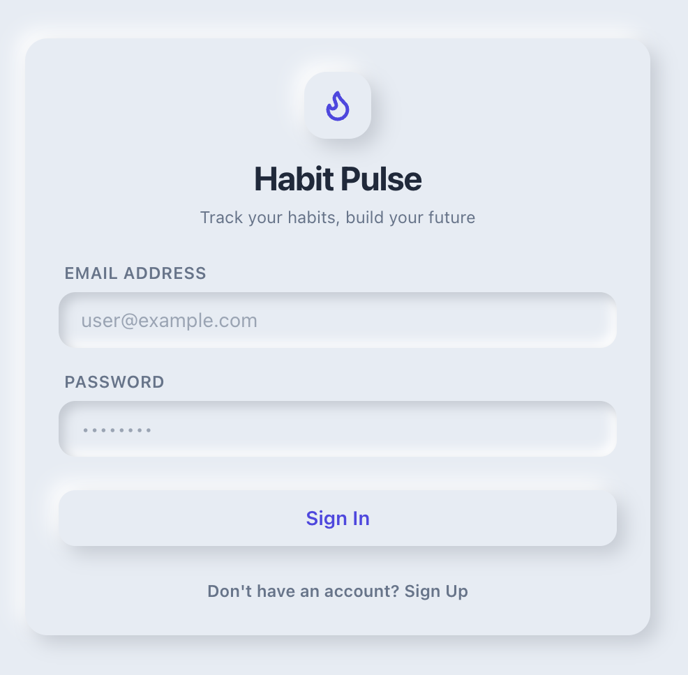
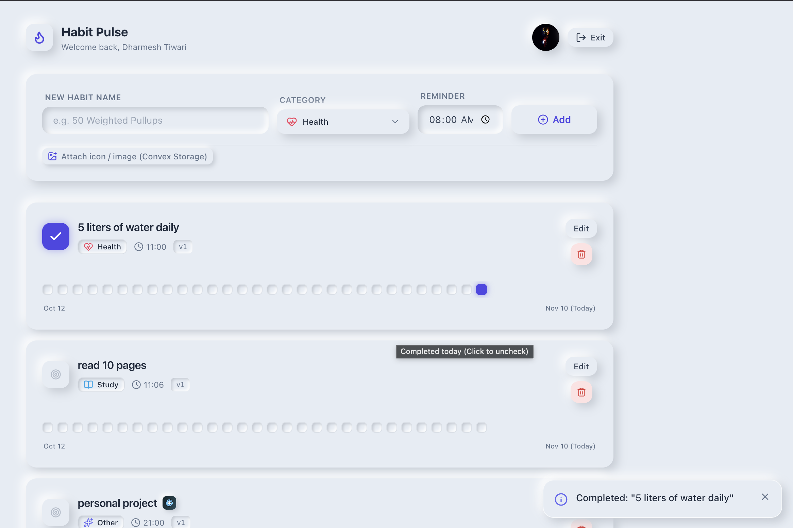

# ⚡ Habit Pulse

A production-grade, reactive habit tracking application built with **Convex** (Backend-as-a-Service) and **React (TypeScript)**. Styled with a custom tactile **Neumorphic design system** using Tailwind CSS.

This project demonstrates core backend primitives: optimistic concurrency control (OCC), real-time WebSocket subscriptions, deduplication, sliding-window rate limiting, scheduled actions, crons, and file storage.

---

## Screenshots





## 🚀 Key Features & Convex Concepts Demonstrated

1. **Real-time Reactive Data (`useQuery`):**
   * Live UI sync via WebSockets without manual polling or cache refetching.
   * Multi-tab instant state updates.

2. **Optimistic Concurrency Control (OCC) & Versioning:**
   * Atomically versioned updates (`v.number()`).
   * Explicit check against stale edits (`doc.version !== expectedVersion`) with a simulated multi-tab conflict tester.

3. **Backend Deduplication & Indexing:**
   * Compound index-backed uniqueness check (`by_user_title`) to prevent duplicate active habit titles.

4. **Sliding-Window Rate Limiter:**
   * Database-backed rolling window timestamp limiter (`rateLimits` table) guarding auth attempts and mutation spamming.

5. **Actions & Schedulers:**
   * `ctx.scheduler.runAt`: Precise epoch timestamp scheduling that adjusts for client timezone offsets to deliver reminders.
   * `internalAction`: Non-deterministic runtime simulating push notifications and external webhooks.

6. **Cron Jobs (`crons.ts`):**
   * Recurring daily midnight audit triggers via `internalMutation`.

7. **Convex File Storage:**
   * Direct binary image uploads using one-time signed URLs (`generateUploadUrl`).
   * Public CDN image serving via reactive `getImageUrl` for user avatars and custom habit assets.

8. **Neumorphic UI & UX:**
   * Lightweight custom component kit (`NeuCard`, `NeuButton`, `NeuInput`, `NeuCategorySelect`, `UserAvatar`).
   * 30-day GitHub-style mini activity heatmap grid.
   * Toast notification system parsing structured `ConvexError` objects.

---

## 🛠️ Tech Stack

* **Frontend:** React 18, TypeScript, Vite, Tailwind CSS, Lucide Icons
* **Backend:** Convex (`convex/server`, `convex/values`)
* **State & Sync:** Convex React Client (`ConvexProvider`)

---

## 📁 Project Architecture

```text
habit-pulse/
├── convex/
│   ├── auth/              # Auth mutations, session store & profile logic
│   ├── common/            # Rate limiting, OCC helpers & auth guards
│   ├── habits/            # Habit queries, OCC mutations & dedup logic
│   ├── jobs/              # Schedulers, actions & notification handlers
│   ├── storage/           # Signed URL generation & asset handlers
│   ├── crons.ts           # Recurring midnight jobs
│   └── schema.ts          # Central typed schema & compound indexes
├── src/
│   ├── components/
│   │   ├── habit/         # HabitCard, HeatmapGrid
│   │   ├── profile/       # ProfileView
│   │   └── ui/            # Neumorphic Kit (Button, Card, Input, Avatar)
│   ├── context/           # ToastContext & auto-dismiss popover state
│   ├── lib/               # Error parser, categories & date helpers
│   ├── App.tsx            # Main layout & dashboard navigation
│   └── main.tsx           # React root & ConvexProvider setup
```

## ⚙️ Getting Started
- Node.js: >=20.19.0 (Recommended: v22.x)
- npm: >=10.x


1. Installation
Clone the repository and install dependencies:
```
git clone <YOUR_REPO_URL>
cd habit-pulse
npm install
```

2. Configure Convex
Initialize your Convex backend deployment (generates .env.local and convex/_generated/ types):
```
npx convex dev
```

3. Run Development Server
In a separate terminal window, start the Vite development server:
```
npm run dev
```

## 🧪 Testing Edge Cases
- OCC Conflict Simulation: Open a habit card, click Edit, and select Test Conflict (Stale Version) to verify server-side rollback and error parsing.

- Reactive Sync: Open the application in two side-by-side browser tabs. Toggle a habit completion in one tab to view instantaneous updates in the other without refreshing.

- Rate Limiter: Submit the login or registration form repeatedly to trigger the sliding-window block.